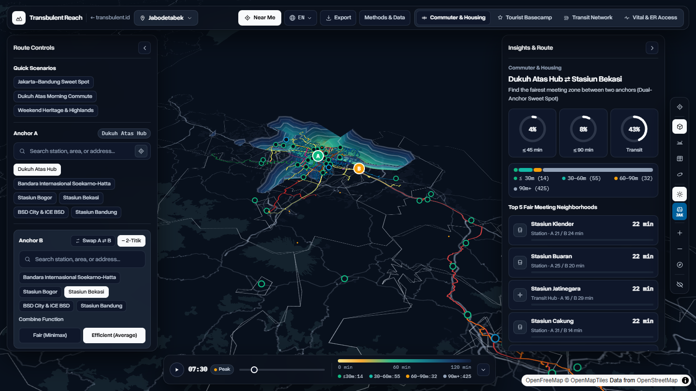
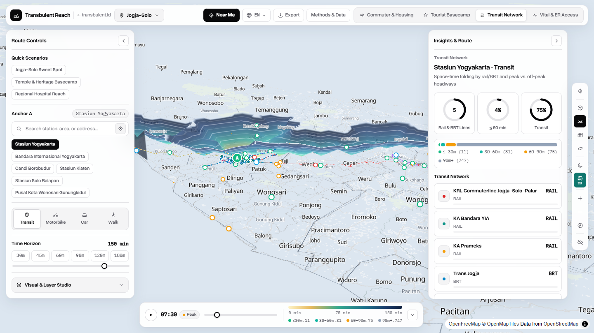
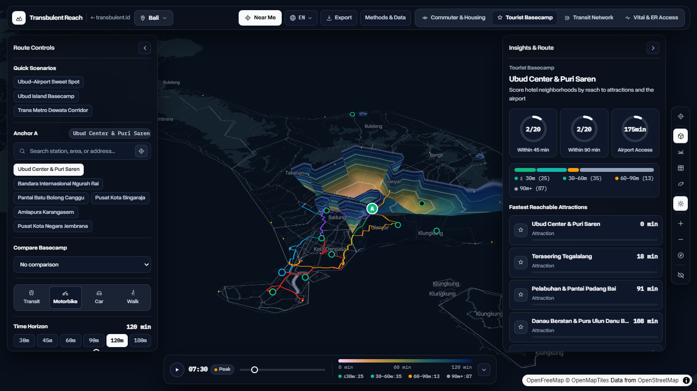
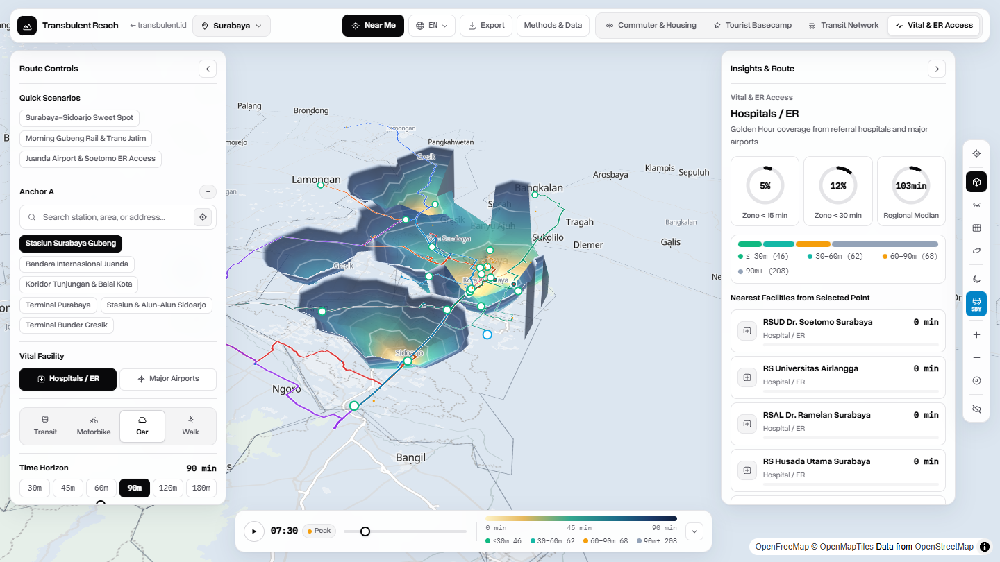

<div align="center">

# Transbulent Reach Core (`reach.transbulent.id`)

**WebGL2 3D Travel-Time Topography (*Travel-Time as Elevation*) Engine & Time-Dependent Multimodal Web Worker Router**

[](https://reach.transbulent.id)
[](https://reach.transbulent.id/metode/)
[](LICENSE)
[](https://www.typescriptlang.org)
[](https://maplibre.org)

[Live 3D Observatory](https://reach.transbulent.id/) · [Methodology](https://reach.transbulent.id/metode/) · [Architecture](docs/ARCHITECTURE.md) · [Security & ToS](SECURITY.md)

</div>

---

## Visual Showcase

<table>
  <tr>
    <td width="50%">
      
      <p align="center"><sub><strong>Jabodetabek Dual-Anchor Sweet Spot (<code>3D Dark</code>):</strong> Dukuh Atas ⇄ Bekasi minimax/mean travel-time basin with MRT, KRL, Whoosh &amp; JakLingko corridors</sub></p>
    </td>
    <td width="50%">
      
      <p align="center"><sub><strong>Yogyakarta–Solo Transit Network (<code>Horizon Light</code>):</strong> 15-minute hypsometric contour ridges with KRL Jogja–Solo–Palur, YIA Airport Rail &amp; Trans Jogja</sub></p>
    </td>
  </tr>
  <tr>
    <td width="50%">
      
      <p align="center"><sub><strong>Bali Tourist Basecamp (<code>3D Crameri</code>):</strong> Motorbike travel-time valley centered on Ubud with 45/90-min attraction reach and airport transfer scoring</sub></p>
    </td>
    <td width="50%">
      
      <p align="center"><sub><strong>Surabaya Vital ER Access (<code>3D Atlas</code>):</strong> Multi-source Dijkstra (<code>t = 0</code> across referral hospitals) showing Golden Hour coverage basins</sub></p>
    </td>
  </tr>
</table>

---

## Overview

Inspired by Cedric Scherer's *30DayMapChallenge* travel-time elevation experiment, **Transbulent Reach** projects multimodal travel duration into continuous 3D terrain: fast transit and highway corridors carve luminous **valleys**, while congested bottlenecks and underserved fringes rise into steep **cliffs**.

The live observatory at [reach.transbulent.id](https://reach.transbulent.id/) covers **7 Indonesian metropolitan regions** — **Jabodetabek + Whoosh Bandung**, **Surabaya (Gerbangkertosusila)**, **Semarang (Kedungsepur)**, **Yogyakarta–Solo–Borobudur**, **Bali**, **Medan (Mebidangro)**, and **Makassar (Mamminasata)** — across **4 decision modes**:

1. **Commuter / Housing Sweet Spot**: Dual-anchor minimax (`max(T_A, T_B)`) and mean (`0.5 * (T_A + T_B)`) commute optimization with fairness-gap ranking.
2. **Tourist Basecamp**: Accessibility scoring (`< 45 min`, `< 90 min`, airport transfer) across heritage and scenic destinations, with side-by-side origin comparison.
3. **Public Transit Explorer**: Time-dependent multimodal graph modeling operating hours, peak vs. off-peak headway waiting penalties, and inter-line transfer costs.
4. **Vital Access (Hospital / Airport)**: Multi-source shortest-path routing (`t = 0` seeded across all target facilities) with coverage thresholds and median response times.

---

## Open-Source Core vs. Private Production Boundary

This repository publishes the **reusable TypeScript core engine** — the WebGL2 3D terrain renderer, multimodal routing algorithms, typed graph contract, high-DPI PNG compositor, synthetic fixture, and automated test suite — while keeping deployment secrets, edge security controls, and curated regional datasets private.

| Component | Status | Notes |
| :--- | :---: | :--- |
| WebGL2 3D Terrain Custom Layer (`src/core/reach-terrain-layer.ts`) | **Public (MIT)** | GLSL ES 3.00 vertex morphing, blended facet/smooth normals, `fwidth` contours, coastal cliff skirts |
| Time-Dependent Multimodal Router (`src/core/routing-engine.ts`) | **Public (MIT)** | Binary min-heap Dijkstra, dual-anchor sweet spot, basecamp scoring, multi-source vital access |
| Web Worker Adapter (`src/core/reach-worker.ts`) | **Public (MIT)** | Zero-copy `Transferable` `Float32Array` surface buffer messaging |
| Graph Schema & PNG Compositor (`reach-types.ts`, `reach-export.ts`) | **Public (MIT)** | Compact tuple schema + `16:9` / `4:5` publication card exporter |
| Synthetic Metro Fixture & Unit Tests (`examples/`, `tests/`) | **Public (MIT)** | Zero-dependency `node:test` verification suite |
| Edge API Worker & Security Rules | **Private** | Cloudflare Worker routing, origin validation, rate-limiting & Google Maps secret integration |
| Regional Curation & GTFS/OSM Pipelines | **Private** | Empirical congestion calibration, GTFS/Dishub ingestion & compiled 7-metro region bundles |

---

## Module Map

```text
reach-the-city/
├── src/
│   ├── index.ts                      # Barrel exports for core engine & types
│   └── core/
│       ├── reach-types.ts            # RegionBundle, compact edge tuples, request/result contracts
│       ├── routing-engine.ts         # Time-dependent Dijkstra, dual-anchor, basecamp, vital, journey
│       ├── reach-worker.ts           # Web Worker wrapper with transferable Float32Array buffers
│       ├── reach-terrain-layer.ts    # MapLibre GL WebGL2 CustomLayerInterface (3D relief & shaders)
│       └── reach-export.ts           # High-DPI 16:9 and 4:5 PNG card compositor
├── examples/
│   └── synthetic-metro.json          # Self-contained fictional metro graph for tests & experimentation
├── tests/
│   └── routing-engine.test.ts        # Node built-in test suite covering all 4 decision modes
├── scripts/
│   └── security-check.mjs            # Pre-release & CI scanner for secrets, IDs, emails, and paths
└── docs/
    └── ARCHITECTURE.md               # Rendering pipeline, routing math & edge integration contract
```

---

## Quickstart

Requires **Node.js 22+**.

```bash
# 1. Install dependencies
npm install

# 2. Typecheck in strict mode
npm run typecheck

# 3. Compile TypeScript and run the routing engine test suite
npm test

# 4. Run the repository security audit
npm run check:security

# Or run all checks together
npm run check
```

---

## Documentation & Policies
- [Architecture](docs/ARCHITECTURE.md) — WebGL2 relief shaders, time-dependent routing math, and JSON bundle schema
- [Security & ToS Policy](SECURITY.md) — Credential isolation, Google Maps Platform ToS compliance, and reporting
- [Third-Party Notices](THIRD_PARTY_NOTICES.md) — Open-source libraries, map tiles, and civic transit data attributions
- [Citation](CITATION.cff) · [MIT License](LICENSE)
